# Plateforme DevSecOps Cloud — CI/CD sécurisée vers Azure Kubernetes Service

[](https://github.com/MorabetYahia/devsecops-cloud/actions/workflows/deploy.yml)


À chaque `git push`, une chaîne automatisée **teste** le code, **scanne** les secrets, le code, l'infrastructure et l'image Docker, puis **déploie** l'application sur un cluster Kubernetes managé Azure (AKS). L'infrastructure est entièrement décrite en **Terraform**. Si un contrôle échoue, **rien n'est déployé**.

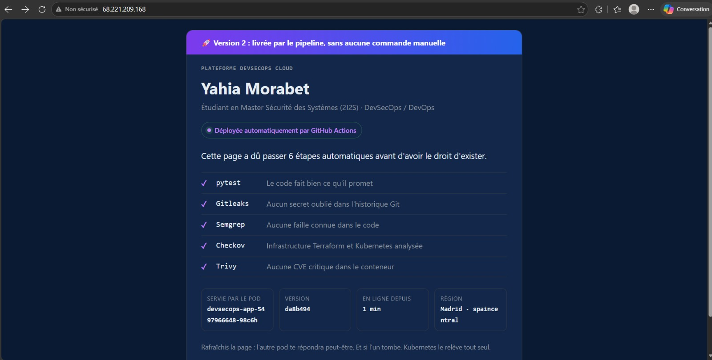
*L'application en production sur AKS, servie par une IP publique Azure. La version affichée (`da8b494`) est le commit Git déployé par le pipeline, sans aucune commande manuelle.*

---

## Sommaire

- [Architecture](#architecture)
- [Stack technique](#stack-technique)
- [Le pipeline CI/CD](#le-pipeline-cicd)
- [Choix de sécurité](#choix-de-sécurité)
- [Infrastructure as Code (Terraform)](#infrastructure-as-code-terraform)
- [Déploiement Kubernetes](#déploiement-kubernetes)
- [Déploiement continu : la preuve](#déploiement-continu--la-preuve)
- [Supervision (Prometheus & Grafana)](#supervision-prometheus--grafana)
- [Structure du dépôt](#structure-du-dépôt)
- [Lancer le projet](#lancer-le-projet)
- [Coûts](#coûts)
- [Difficultés rencontrées et solutions](#difficultés-rencontrées-et-solutions)
- [Risques acceptés et améliorations](#risques-acceptés-et-améliorations)
- [Feuille de route](#feuille-de-route)

---

## Architecture

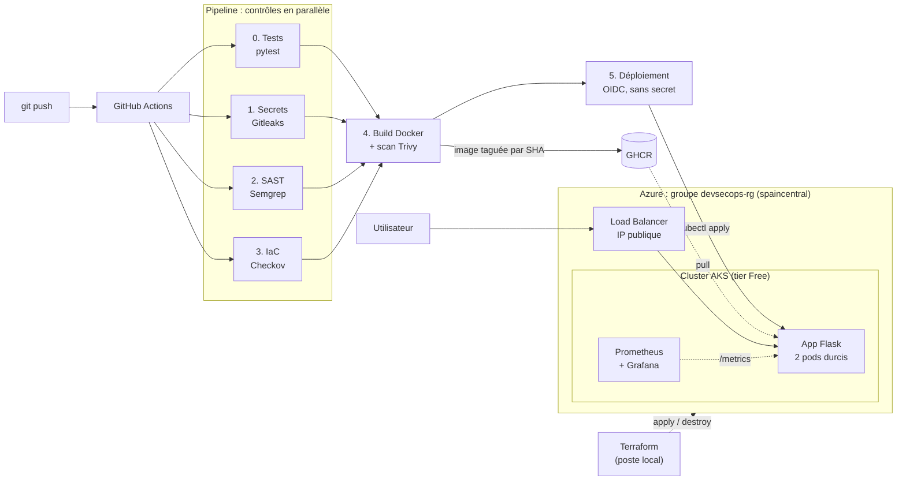

L'infrastructure est **éphémère** : elle est créée avec `terraform apply` en début de session et supprimée avec `terraform destroy` en fin de session, pour maîtriser les coûts.

## Stack technique

| Domaine | Outils |
|---|---|
| Cloud | Microsoft Azure : AKS (tier Free), VNet, Load Balancer, Entra ID |
| Infrastructure as Code | Terraform 1.17, provider `azurerm` 4.81 |
| Application | Python 3.12, Flask, Gunicorn, Jinja2 |
| Conteneurs | Docker, GitHub Container Registry (GHCR) |
| Orchestration | Kubernetes 1.36 (AKS), Helm |
| CI/CD | GitHub Actions, Dependabot |
| Sécurité | Gitleaks, Semgrep, Checkov, Trivy, OIDC, en-têtes HTTP (CSP) |
| Tests | pytest |
| Supervision | Prometheus, Grafana (kube-prometheus-stack) |

---

## Le pipeline CI/CD

Fichier : [`.github/workflows/deploy.yml`](.github/workflows/deploy.yml). Il est déclenché à chaque push, à chaque Pull Request et manuellement.

| Job | Outil | Ce qu'il vérifie | En cas d'échec |
|---|---|---|---|
| 0. Tests | pytest | Pages, API, `/health`, `/metrics`, en-têtes de sécurité, 404 | **Bloque** |
| 1. Secrets | Gitleaks | Clés, mots de passe ou jetons dans **tout l'historique Git** | **Bloque** |
| 2. SAST | Semgrep (`p/python`, `p/dockerfile`) | Failles connues dans le code et le Dockerfile | **Bloque** |
| 3. IaC | Checkov | Configuration Terraform, Kubernetes et Dockerfile | Signale (onglet *Security*, SARIF) |
| 4. Build + scan | Docker + Trivy | CVE **CRITICAL/HIGH** corrigeables dans l'image | **Bloque** ; sinon publication sur GHCR |
| 5. Déploiement | Azure OIDC + kubectl | Mise en production sur AKS, attente du rollout | Échec visible, l'ancienne version reste en ligne |

Les jobs 0 à 3 tournent **en parallèle**. Le build attend qu'ils soient **tous verts**, et le déploiement attend le build. Le job 5 ne s'exécute que sur `main`, et seulement quand le cluster existe (variable `CLUSTER_UP`).

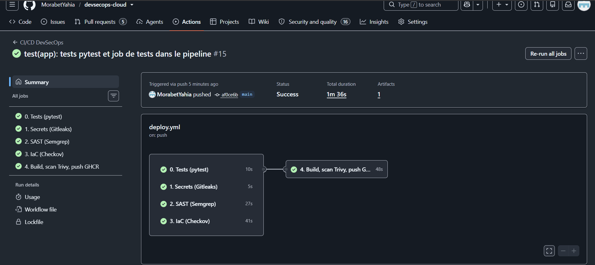
*Exécution sur `main` : les contrôles s'exécutent en parallèle, et le build ne démarre qu'après leur succès.*

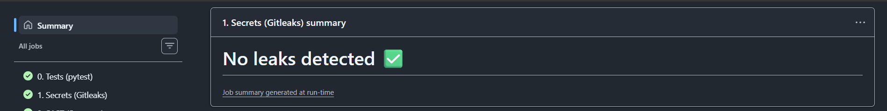
*Résumé du job Gitleaks : aucun secret dans l'historique du dépôt.*

**Les mises à jour automatiques passent aussi par la chaîne.** Chaque Pull Request ouverte par Dependabot (actions, dépendances pip, image Docker) est testée et scannée avant de pouvoir être fusionnée :

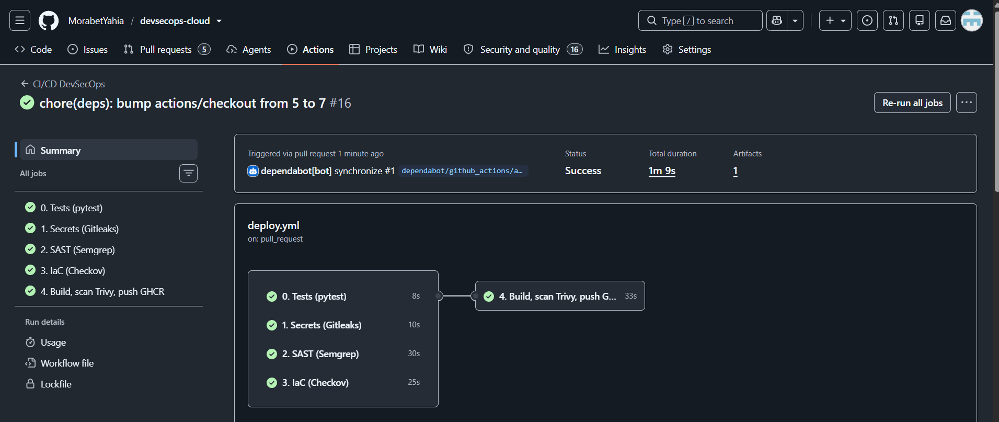

<details>
<summary><b>Extrait : scan d'image bloquant (job 4)</b></summary>

```yaml
- name: Scan image (bloque si CRITICAL/HIGH corrigeable)
  uses: aquasecurity/trivy-action@<SHA> # v0.36.0, épinglée par SHA
  with:
    image-ref: ${{ env.IMAGE }}:${{ github.sha }}
    exit-code: '1'
    severity: CRITICAL,HIGH
    ignore-unfixed: true
```
</details>

---

## Choix de sécurité

| Mesure | Mise en œuvre | Ce qu'elle empêche |
|---|---|---|
| **Aucun secret cloud stocké** | GitHub s'authentifie à Azure par **OIDC** (identité fédérée) : un jeton temporaire est émis à chaque déploiement | Le vol d'une clé Azure en cas de fuite du dépôt |
| **Moindre privilège** | L'identité du pipeline a un seul rôle, *AKS Cluster User Role*, **sur ce seul cluster** | Qu'un pipeline compromis touche au reste de l'abonnement |
| **Confiance OIDC restreinte** | Seuls les jetons du dépôt **et** de l'environnement `production` sont acceptés (identifiants numériques GitHub inclus) | L'usurpation par un autre dépôt, même s'il porte le même nom |
| **Supply chain** | Les actions tierces sont **épinglées par SHA de commit** ; Dependabot propose les mises à jour | Le scénario de mars 2026, où 75 des 76 tags de `trivy-action` ont été réécrits vers un voleur de secrets |
| **Traçabilité** | Chaque image est taguée avec le SHA du commit, affiché par l'application | Ne pas savoir quel code tourne en production |
| **Conteneur durci** | Image `slim` mise à jour, utilisateur **non-root** (UID 10001), Gunicorn au lieu du serveur de développement | Une élévation de privilèges dans le conteneur |
| **Pods durcis** | `runAsNonRoot`, `readOnlyRootFilesystem`, `capabilities: drop ALL`, `allowPrivilegeEscalation: false`, seccomp `RuntimeDefault`, pas de jeton de service monté, limites CPU/mémoire | L'écriture de binaires, l'escalade, l'épuisement des ressources |
| **En-têtes HTTP** | `Content-Security-Policy` stricte (`default-src 'none'`), `X-Content-Type-Options: nosniff`, `Referrer-Policy: no-referrer`, `frame-ancestors 'none'` | Le XSS, le clickjacking, le sniffing MIME |
| **Templates échappés** | Rendu Jinja2 avec échappement automatique, aucune ressource externe chargée | L'injection HTML / XSS |
| **State Terraform hors Git** | `*.tfstate`, `*.tfvars` et `tfplan` exclus par `.gitignore` | La fuite des accès au cluster contenus dans le state |
| **Supervision privée** | Grafana n'a pas d'IP publique : accès par `kubectl port-forward` uniquement | L'exposition de l'interface d'administration |

<details>
<summary><b>Extrait : contexte de sécurité du Deployment</b></summary>

```yaml
securityContext:
  runAsNonRoot: true
  runAsUser: 10001
  seccompProfile: { type: RuntimeDefault }
containers:
  - name: app
    securityContext:
      allowPrivilegeEscalation: false
      readOnlyRootFilesystem: true
      capabilities: { drop: ["ALL"] }
    resources:
      requests: { cpu: 50m, memory: 64Mi }
      limits: { cpu: 250m, memory: 128Mi }
```
</details>

---

## Infrastructure as Code (Terraform)

Dossier : [`terraform/`](terraform/). Une commande crée l'environnement complet en environ 4 minutes, une autre le supprime.

| Ressource | Rôle |
|---|---|
| `azurerm_resource_group` | Groupe `devsecops-rg`, région `spaincentral` |
| `azurerm_virtual_network` + `azurerm_subnet` | Réseau privé `10.10.0.0/16`, sous-réseau des nœuds `10.10.1.0/24` |
| `azurerm_kubernetes_cluster` | AKS tier **Free**, 1 nœud `Standard_B2s_v2`, réseau Azure CNI *overlay* (pods en `192.168.0.0/16`, services en `10.20.0.0/16`), RBAC activé |
| `azurerm_role_assignment` (×2) | *Network Contributor* pour que le cluster gère son Load Balancer ; *Cluster User Role* pour le pipeline (OIDC) |

<details>
<summary><b>Extrait : le cluster AKS</b></summary>

```hcl
resource "azurerm_kubernetes_cluster" "aks" {
  name                = "${var.prefix}-aks"
  location            = azurerm_resource_group.rg.location
  resource_group_name = azurerm_resource_group.rg.name
  dns_prefix          = "${var.prefix}aks"
  sku_tier            = "Free" # plan de contrôle sans frais

  default_node_pool {
    name           = "system"
    node_count     = 1
    vm_size        = var.node_vm_size # Standard_B2s_v2
    vnet_subnet_id = azurerm_subnet.aks.id
  }

  identity { type = "SystemAssigned" }

  network_profile {
    network_plugin      = "azure"
    network_plugin_mode = "overlay"
    pod_cidr            = "192.168.0.0/16"
    service_cidr        = "10.20.0.0/16"
    dns_service_ip      = "10.20.0.10"
    load_balancer_sku   = "standard"
  }
}
```
</details>

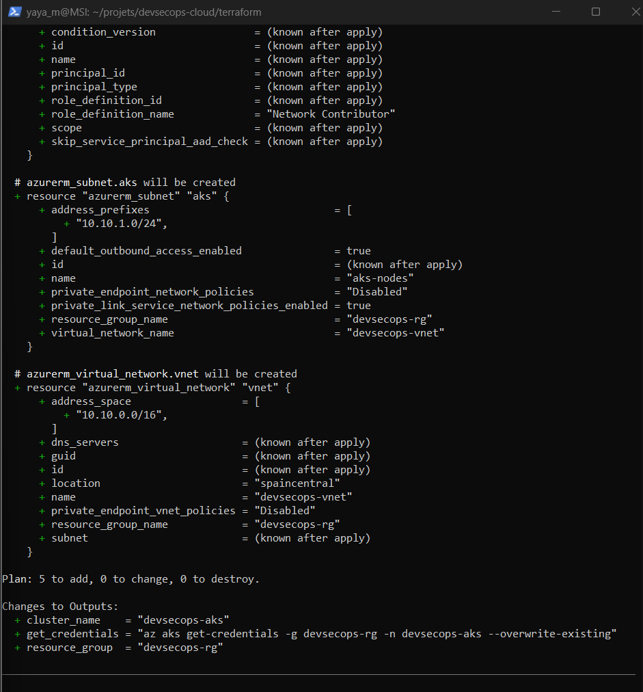
*`terraform plan` : 5 ressources à créer, aucune modification inattendue.*

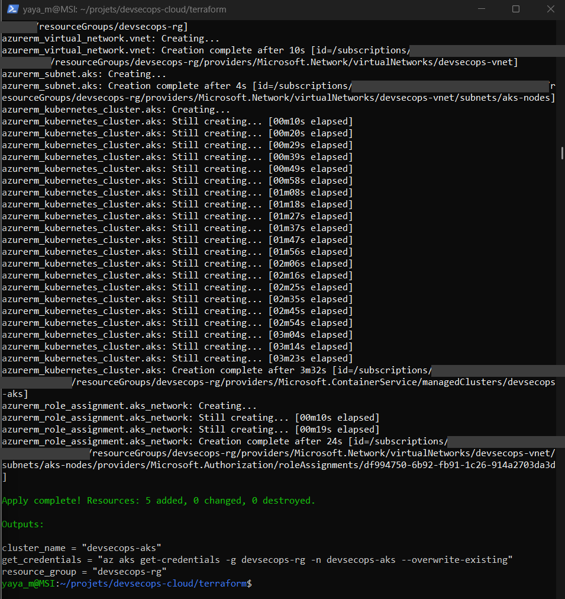
*`terraform apply` : environnement créé, cluster AKS en 3 min 32 s. Les identifiants d'abonnement sont masqués.*

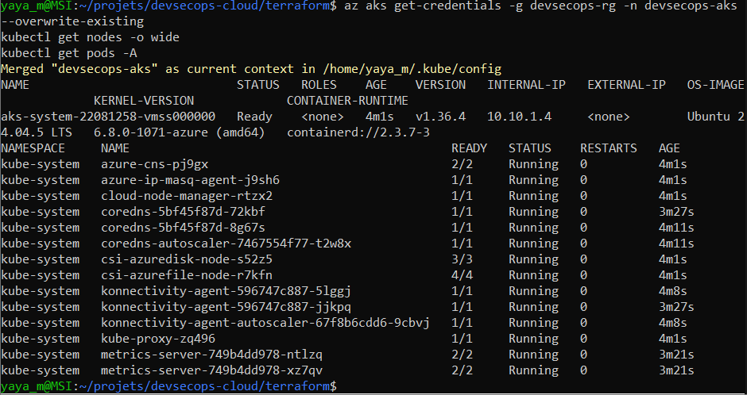
*Connexion au cluster : 1 nœud `Ready` (Kubernetes v1.36.4, IP interne `10.10.1.4` dans le sous-réseau Terraform) et composants système opérationnels.*

---

## Déploiement Kubernetes

Dossier : [`k8s/`](k8s/).

| Manifeste | Rôle |
|---|---|
| `deployment.yaml` | 2 réplicas durcis, sondes `readiness` / `liveness` sur `/health`, limites de ressources |
| `service.yaml` | Service `LoadBalancer` : IP publique Azure, port 80, répartition entre les pods |
| `servicemonitor.yaml` | Indique à Prometheus de collecter `/metrics` toutes les 15 s |

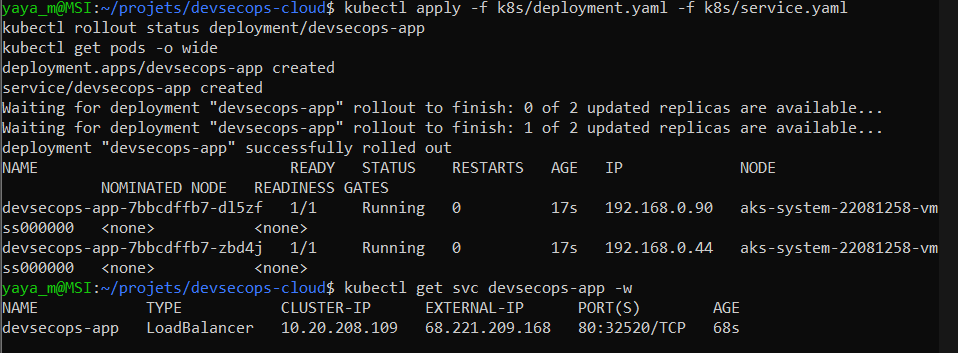
*Premier déploiement : rollout progressif des 2 réplicas, puis attribution de l'IP publique par Azure.*

L'application expose :

| Route | Contenu |
|---|---|
| `/` | Page de présentation : pod qui répond, version (SHA), uptime |
| `/api/info` | Les mêmes informations en JSON |
| `/health` | Sonde de santé pour Kubernetes |
| `/metrics` | Métriques Prometheus (requêtes, latence, codes HTTP) |

---

## Déploiement continu : la preuve

Le changement de design ci-dessous a été mis en ligne par **un simple `git push`** : tests, scans, build, scan d'image, puis rollout sur AKS sans interruption, sans aucune commande `kubectl` manuelle.

| Avant (version `66ac627`) | Après un `git push` (version `da8b494`) |
|---|---|
| 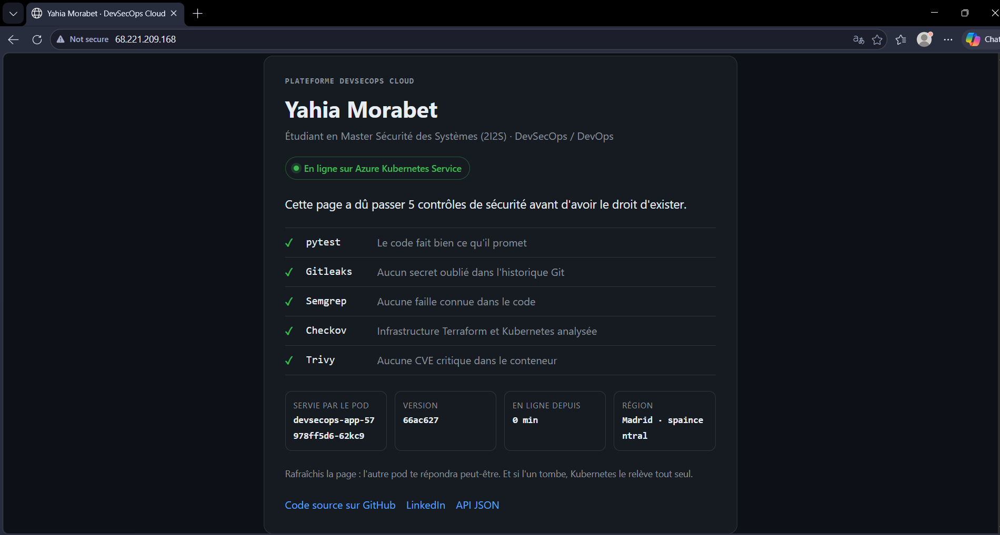 |  |

<details>
<summary><b>Extrait : le job de déploiement (OIDC)</b></summary>

```yaml
deploy:
  name: 5. Déploiement AKS
  needs: build-scan-push
  if: github.ref == 'refs/heads/main' && vars.CLUSTER_UP == 'true'
  environment: production
  permissions:
    contents: read
    id-token: write # jeton OIDC à durée de vie courte
  steps:
    - uses: actions/checkout@v5
    - uses: azure/login@v2
      with:
        client-id: ${{ secrets.AZURE_CLIENT_ID }}
        tenant-id: ${{ secrets.AZURE_TENANT_ID }}
        subscription-id: ${{ secrets.AZURE_SUBSCRIPTION_ID }}
    - uses: azure/setup-kubectl@v4
    - run: az aks get-credentials -g devsecops-rg -n devsecops-aks --overwrite-existing
    - run: |
        sed -i "s|$IMAGE:latest|$IMAGE:${GITHUB_SHA}|" k8s/deployment.yaml
        sed -i "s|value: \"dev\"|value: \"${GITHUB_SHA::7}\"|" k8s/deployment.yaml
        kubectl apply -f k8s/deployment.yaml -f k8s/service.yaml
        kubectl rollout status deployment/devsecops-app --timeout=180s
```

Les trois secrets ne sont que des **identifiants publics** (application, tenant, abonnement) : aucun mot de passe ni aucune clé n'est stocké.
</details>

---

## Supervision (Prometheus & Grafana)

La pile `kube-prometheus-stack` est installée par Helm avec des réglages adaptés à un nœud unique ([`monitoring/values.yaml`](monitoring/values.yaml)). Le tableau de bord est versionné en JSON ([`monitoring/dashboard.json`](monitoring/dashboard.json)) et chargé automatiquement par Grafana (*dashboard as code*).

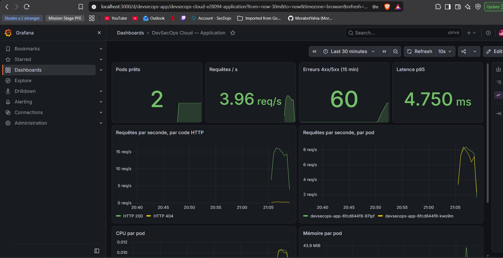
*Sous un trafic de test : 2 pods prêts, latence p95 d'environ 5 ms. Les erreurs 4xx correspondent aux requêtes simulées vers `/wp-login.php`, le même type de scan que celui des robots qui parcourent Internet.*

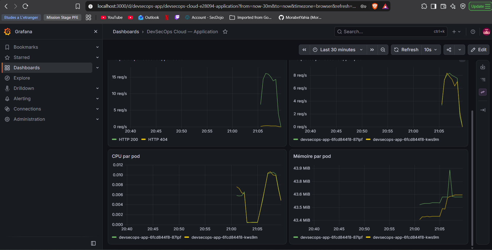
*Le Load Balancer répartit les requêtes à parts égales entre les 2 pods ; CPU et mémoire restent très en dessous des limites (≈ 0,01 cœur, ≈ 44 Mio).*

---

## Structure du dépôt

```
devsecops-cloud/
├── app/
│   ├── app.py                  # Flask : /, /api/info, /health, /metrics + en-têtes de sécurité
│   ├── templates/index.html    # page de présentation (Jinja2, échappement automatique)
│   ├── test_app.py             # 6 tests pytest
│   ├── requirements.txt        # dépendances épinglées
│   ├── requirements-dev.txt    # pytest (hors image de production)
│   └── Dockerfile              # image durcie, non-root, gunicorn
├── terraform/
│   ├── versions.tf  variables.tf  main.tf  outputs.tf
│   └── .terraform.lock.hcl     # version du provider figée
├── k8s/
│   ├── deployment.yaml  service.yaml  servicemonitor.yaml
├── monitoring/
│   ├── values.yaml             # réglages kube-prometheus-stack
│   └── dashboard.json          # tableau de bord Grafana
├── .github/
│   ├── workflows/deploy.yml    # pipeline CI/CD en 6 jobs
│   └── dependabot.yml
├── docs/screenshots/
├── SECURITY.md
└── LICENSE
```

---

## Lancer le projet

### Prérequis

- Un abonnement Azure (ici *Azure for Students*), avec Azure CLI connecté (`az login`) ;
- Terraform ≥ 1.6, kubectl, Helm, Docker, GitHub CLI (`gh`) ;
- Une configuration OIDC unique : une application Entra ID avec une identité fédérée pour `repo:<owner>/<repo>:environment:production`, et les secrets `AZURE_CLIENT_ID`, `AZURE_TENANT_ID` et `AZURE_SUBSCRIPTION_ID` dans le dépôt.

### Début de session

```bash
cd terraform
export TF_VAR_subscription_id=$(az account show --query id -o tsv)
terraform apply                       # github_principal_id dans terraform.tfvars (non versionné)
az aks get-credentials -g devsecops-rg -n devsecops-aks --overwrite-existing

gh variable set CLUSTER_UP --body true
gh workflow run deploy.yml            # le pipeline déploie l'application

helm upgrade --install monitoring prometheus-community/kube-prometheus-stack \
  -n monitoring --create-namespace -f ../monitoring/values.yaml --wait
kubectl apply -f ../k8s/servicemonitor.yaml
kubectl -n monitoring create configmap devsecops-dashboard --from-file=../monitoring/dashboard.json
kubectl -n monitoring label configmap devsecops-dashboard grafana_dashboard=1
kubectl -n monitoring port-forward svc/monitoring-grafana 3000:80
```

### Fin de session

```bash
gh variable set CLUSTER_UP --body false   # le job 5 est ignoré tant que le cluster n'existe pas
cd terraform && terraform destroy
az group list -o table                    # vérifier qu'il ne reste aucun groupe devsecops
```

### Tests en local

```bash
docker run --rm -v "$PWD/app":/app -w /app python:3.12-slim \
  sh -c "pip install -q -r requirements.txt -r requirements-dev.txt && pytest -v"
```

---

## Coûts

Le projet fonctionne **sans aucune dépense** : il utilise uniquement le crédit *Azure for Students* (sans carte bancaire), ainsi que les offres gratuites de GitHub (Actions et GHCR sur un dépôt public).

| Choix | Économie |
|---|---|
| AKS **tier Free** | Plan de contrôle sans frais |
| 1 nœud `Standard_B2s_v2` | Seule ressource de calcul facturée |
| GHCR au lieu d'Azure Container Registry | Registre gratuit |
| Sortie Internet via le Load Balancer AKS | Pas de NAT Gateway |
| Prometheus + Grafana dans le cluster | Pas de facturation Azure Monitor au volume de logs |
| Infrastructure **éphémère** (`apply` / `destroy`) | Crédit consommé uniquement pendant les sessions de travail (quelques centimes par heure) |

---

## Difficultés rencontrées et solutions

| Problème | Cause | Solution |
|---|---|---|
| Déploiement refusé dans la région choisie | *Azure for Students* n'autorise qu'une liste de régions par abonnement | Lecture de la politique *Allowed locations*, choix de `spaincentral` ; `Standard_B2s` indisponible, remplacé par `Standard_B2s_v2` |
| Job Checkov en échec | Chemin du rapport SARIF introuvable avec l'action officielle | Checkov installé via pip, rapport dans un dossier dédié ; publication sans bloquer les PR Dependabot |
| `AADSTS700213` à la connexion OIDC | GitHub présente désormais un *subject* incluant les identifiants numériques du compte et du dépôt | Ajout d'une identité fédérée correspondant au nouveau format (protection contre la réutilisation d'un nom de dépôt) |
| Grafana inaccessible, tunnel coupé en boucle | Événements `OOMKilling` : limite mémoire de 256 Mio trop basse | Diagnostic via `kubectl get events`, limite portée à 512 Mio |
| Application injoignable dans le navigateur (`ERR_TIMED_OUT`) | Le navigateur forçait HTTPS, alors que le service n'expose que le port 80 | Diagnostic avec `curl -v` (réponse 200) ; HTTPS identifié comme amélioration |
| Job de déploiement ignoré | Interrupteur `CLUSTER_UP` resté à `false` après une fin de session | Variable remise à `true`, puis relance du pipeline |
| Outils non installables dans `/usr/local/bin` (WSL) | Répertoire monté en lecture seule | kubectl et Helm installés dans `~/.local/bin` |

---

## Risques acceptés et améliorations

Ce projet est un **laboratoire éphémère**. Les constats Checkov sont publiés dans l'onglet *Security* du dépôt. Voici les principaux risques acceptés pour un lab, avec la correction prévue en production :

| Risque accepté (lab) | En production |
|---|---|
| Application en HTTP | Ingress + cert-manager (Let's Encrypt) pour le HTTPS, voire un WAF |
| API du cluster publique | Cluster privé ou plages d'IP autorisées |
| Authentification Kubernetes locale | Intégration Entra ID et Azure RBAC pour Kubernetes |
| Pas de Network Policies | Politiques réseau limitant les flux entre pods |
| `/metrics` exposé publiquement | Port de métriques interne, non routé par le Load Balancer |
| State Terraform local | Backend distant chiffré (Azure Storage) avec verrouillage |
| Images non signées | Signature Cosign et vérification à l'admission |
| Déploiement « push » depuis la CI | GitOps avec Argo CD ou Flux |

---

## Feuille de route

- [x] Application, tests et image durcie
- [x] Pipeline de sécurité (Gitleaks, Semgrep, Checkov, Trivy)
- [x] Infrastructure AKS en Terraform
- [x] Déploiement continu par OIDC
- [x] Supervision Prometheus + Grafana
- [ ] Démonstrations de blocage : Pull Requests volontairement vulnérables (secret exposé, injection de commande, dépendance avec CVE)
- [ ] HTTPS avec Ingress et cert-manager

---

## Auteur

**Yahia Morabet**, étudiant en Master Sécurité des Systèmes et Ingénierie Informatique (2I2S), Faculté des Sciences de Rabat. Profil DevSecOps / DevOps.

[GitHub](https://github.com/MorabetYahia) · [LinkedIn](https://www.linkedin.com/in/yahia-morabet-52149639b/)
